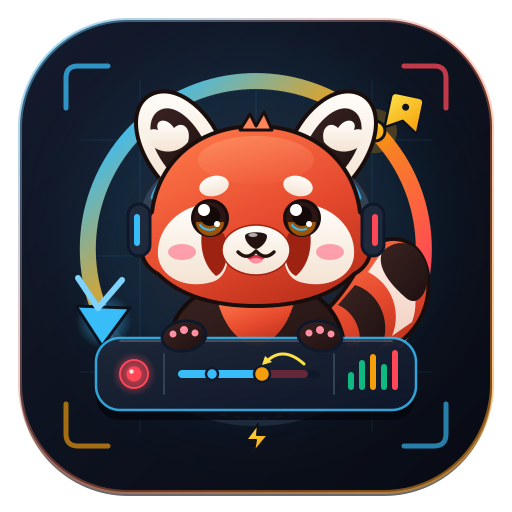

<p align="center">
  
</p>

<h1 align="center">Retake</h1>

<p align="center">
  <strong>The Next-Gen Lightweight Desktop Screen Recorder for Windows</strong><br>
  Built with <em>Rust, Tauri 2, React 18, TypeScript & FFmpeg</em>
</p>

<p align="center">
  <a href="https://github.com/maplexrain/Retake/releases/latest"></a>
  <a href="LICENSE"></a>
  
  
  
  
  
  
</p>

<p align="center">
  <a href="#-key-features">Features</a> •
  <a href="#-the-rollback-workflow">Rollback Concept</a> •
  <a href="#-global-shortcuts">Shortcuts</a> •
  <a href="#-downloads--installation">Downloads</a> •
  <a href="#-quick-start">Quick Start</a> •
  <a href="#-architecture">Architecture</a> •
  <a href="README_zh.md">简体中文</a>
</p>

---

## 💡 Why Retake?

Traditional screen recorders force you to either restart completely when you stumble over a sentence, or spend hours scrubbing through timelines in video editors just to cut out bad takes.

**Retake reimagines recording with live rollbacks:**
Bookmark checkpoints on the fly with <kbd>Alt</kbd>+<kbd>F</kbd>. Flubbed a sentence or demo step? Press <kbd>Alt</kbd>+<kbd>G</kbd> to instantly rewind to your last checkpoint, cleanly discarding the mistake and resuming without breaking your flow.

```
                    ┌───────────────────────── Retake Workflow ─────────────────────────┐
                    │                                                                   │
Recording Timeline: ───[ Part 1: Clean Intro ]───┬───[ Part 2: Flubbed Mistake ]───┐    │
                                                 │                                 │    │
Action:                                     Alt+F Bookmark                    Alt+G Rollback
                                            Checkpoint #1                     (Bad take purged)
                                                 │                                 │    │
Resumed Session:    ─────────────────────────────┴───[ Part 2: Perfect Take ]─────┴──> 💾 Final Merged MP4
```

---

## ✨ Key Features

- **⚡ Checkpoint & Rollback Engine**
  - **Bookmark (`Alt+F`)**: Mark checkpoints in real time without pausing or interrupting capture.
  - **Rollback (`Alt+G`)**: Instant rollbacks drop bad takes and rewind the timeline to the last checkpoint (or beginning if none marked).
  - **Lossless Stream Concatenation**: When finished, all clean segments are seamlessly merged via FFmpeg concat demuxer into a single ready-to-share MP4.
- **🛸 Top Floating HUD (Timeline Progress Bar)**
  - A compact, draggable floating bar pinned to the top-center of your screen during recording.
  - Features a dynamic timeline progress bar, checkpoint pins (`⚑`), elapsed timer, and quick actions (`Mark`, `Rollback`, `Pause`, `Finish`, `Cancel`).
  - Excluded from capture via Windows `WDA_EXCLUDEFROMCAPTURE` — **it will never show up in your finished video**.
- **🎙️ Dual-Source Audio & Real-Time Spectrum Visualizer**
  - High-fidelity microphone input mixed with system sound loopback (WASAPI).
  - Built-in real-time 4-band audio peak visualizer instantly confirms whether your voice or system audio is being picked up.
- **🛡️ Capture Exclusion (Window Invisibility)**
  - Retake's main studio deck and floating HUD are completely invisible to screen capture. Toggleable on/off anytime in settings.
- **🖥️ Precision Capture Scope**
  - Multi-monitor picker with primary screen auto-detection.
  - Arbitrary region cropping: drag an interactive transparent overlay across any desktop rectangle.
- **⏳ Fullscreen Pre-Roll Countdown**
  - Smooth visual countdown with quick-glance status verification badges (Crop size, Mic on, System audio on, Cursor visibility). Cancel anytime with <kbd>ESC</kbd>.
- **📋 Segmented Recording Manifest (`retake_manifest.json`)**
  - Pre-define video segments or lesson takes in a structured manifest (e.g., `01_intro.mp4`, `02_demo.mp4`).
  - Target any clip with one click. Re-recording without switching automatically overwrites the target file, perfect for agile retakes.
  - Automatically records duration, status, and timestamps. Supports inline editing, one-click JSON opening, and instant video preview.
- **🎨 Card-Free Minimal Studio Deck**
  - Zero nested card visual noise. Hairline dividers, unified segmented selectors, and auto-adapting compact height.
- **🌐 Reactive Internationalization (i18n)**
  - English-first by default with an instant one-click toggle to Simplified Chinese (`EN / 中`). Synchronizes reactively across all windows.

---

## ⌨️ Global Shortcuts

Global hotkeys operate universally across all Windows applications even when Retake is minimized or unfocused:

| Shortcut | Action | Scope / Phase |
| :---: | :--- | :--- |
| <kbd>Alt</kbd> + <kbd>1</kbd> | **Start / Finish** | Start recording from idle · Finish and save when recording/paused · Cancel countdown |
| <kbd>Alt</kbd> + <kbd>2</kbd> | **Pause / Resume** | Toggle pause & resume during recording |
| <kbd>Alt</kbd> + <kbd>F</kbd> | **Bookmark Checkpoint** | Mark a rollback pin (`⚑`) at current timestamp |
| <kbd>Alt</kbd> + <kbd>G</kbd> | **Rollback** | Discard all footage after latest checkpoint & continue recording |
| <kbd>Alt</kbd> + <kbd>3</kbd> | **Cancel / Discard** | Discard current session and delete temporary files |

---

## 📦 Downloads & Installation

Head over to the [**Latest Release**](https://github.com/maplexrain/Retake/releases/latest) to download:

| Package | Format | Description |
| :--- | :--- | :--- |
| **`Retake_0.1.1_x64-setup.exe`** | NSIS Installer | Standard Windows installer with desktop and start menu shortcuts |
| **`retake.exe`** | Standalone Portable | Portable executable — run anywhere with zero installation |

---

## 🛠️ System Requirements

| Dependency | Minimum Version | Note |
| :--- | :--- | :--- |
| **OS** | Windows 10 2004+ (Build 19041+) / Windows 11 | Required for `WDA_EXCLUDEFROMCAPTURE` window exclusion |
| **FFmpeg** | Any modern build with `libx264` & `gdigrab` | Core recording & muxing engine |
| **WebView2** | Evergreen Runtime | Built-in on modern Windows 10 and 11 |

> [!TIP]
> **Installing FFmpeg on Windows**:
> ```powershell
> winget install Gyan.FFmpeg
> ```
> Alternatively, download a GPL build from [ffmpeg.org](https://ffmpeg.org/download.html) and add `ffmpeg.exe` to your `PATH`, or set its absolute path in Retake's **Advanced Settings → FFmpeg Path**.

---

## 🚀 Quick Start (Development)

### 1. Clone & Install
```bash
git clone git@github.com:maplexrain/Retake.git
cd Retake
npm install
```

### 2. Run in Development Mode
```bash
npm run dev
# or
npm run tauri dev
```

### 3. Build Production Installer
```bash
npm run tauri build
```
Built binaries and installers will be generated under `src-tauri/target/release/`.

---

## 🏛️ Architecture

```
Retake/
├── src/                          # Frontend (React 18 + TypeScript + Vite)
│   ├── ui/
│   │   ├── Main.tsx              # Studio Deck (Scope, Audio mixer, Controls, Settings)
│   │   ├── FloatingHud.tsx       # Capture-excluded floating HUD with timeline & checkpoints
│   │   ├── Countdown.tsx         # Fullscreen pre-roll countdown overlay
│   │   ├── Selector.tsx          # Interactive crop region selection overlay
│   │   └── icons.tsx             # Streamlined SVG icon system
│   ├── i18n.ts                   # Multi-language store (English & Chinese) with cross-window events
│   ├── api.ts                    # Strongly-typed Tauri IPC invoke wrappers
│   └── styles.css                # Card-free flat studio design stylesheet
│
└── src-tauri/                    # Backend (Rust + Tauri 2 + Windows API)
    ├── src/
    │   ├── main.rs               # Window management, hotkey dispatcher, audio level polling
    │   ├── recorder.rs           # Multi-part session state machine, checkpoint tracking & concat
    │   ├── sysaudio.rs           # WASAPI loopback audio capture & real-time peak metering
    │   ├── win.rs                # Windows API bindings (WDA capture exclusion, monitor enumeration)
    │   ├── ffmpeg_util.rs        # FFmpeg process orchestrator & demuxer builder
    │   └── project.rs            # Settings persistence & configuration schema
    └── Cargo.toml                # Rust dependencies & Windows API feature flags
```

---

## 🤝 Contributing

Contributions are what make the open source community such an amazing place to learn, inspire, and create. Any contributions you make are **greatly appreciated**.

Please read our [Contributing Guidelines](CONTRIBUTING.md) and [Code of Conduct](CODE_OF_CONDUCT.md) before submitting pull requests.

---

## 📄 License

Distributed under the **MIT License**. See [`LICENSE`](LICENSE) for more information.

<p align="center">
  Made with ❤️ by <a href="https://github.com/maplexrain">maplexrain</a>
</p>
